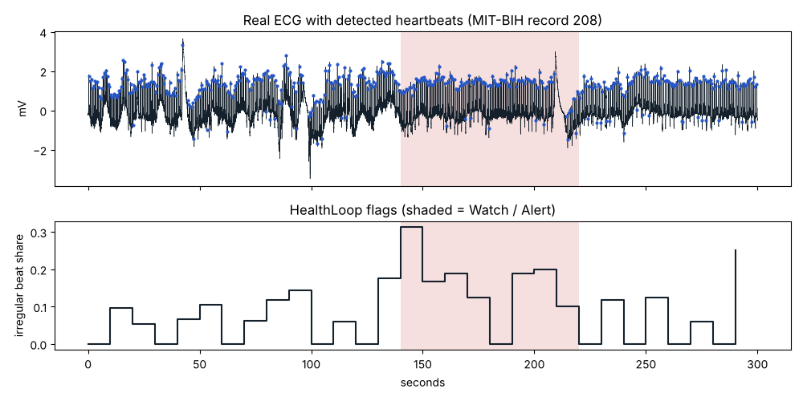
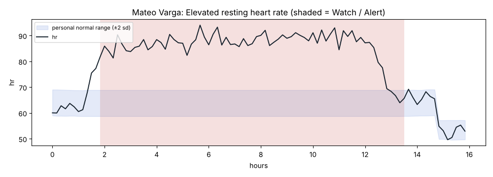

# HealthLoop

**Onboard health monitoring for astronauts on long-duration missions.**
Built for the 2026 NASA Space Apps Challenge, *Create Health Monitoring Software for Astronauts on Space Missions*.

On a Mars mission, Earth can be 3 to 22 light-minutes away and the link can drop out. HealthLoop makes every health
decision on the spacecraft first: it learns each astronaut's own normal for heart rate, recovery (HRV), blood oxygen,
stress and sleep, flags lasting changes in plain language with steps to take right away, and only then sends a tiny,
encrypted summary to Mission Control, where a flight surgeon sees it with its true data age and can acknowledge it.

- **Live demo (runs in the browser, simulated crew):** https://rabiyaaziz.github.io/HealthLoop/ (or open `index.html` from this repo).
- **7-slide demo:** [docs/HealthLoop-demo.pdf](docs/HealthLoop-demo.pdf)
- **Full version:** the Python server below runs the same dashboard on the Python engine, with local AI features.

> HealthLoop is a hackathon prototype using simulated data. It is not a medical device.

```
healthloop-py/
├── healthloop/
│   ├── detection.py   personal-baseline anomaly detector (the core)
│   ├── simulate.py    4-person simulated crew + fault scenarios
│   ├── packets.py     7-byte telemetry records, AES-GCM sealing
│   ├── datasets.py    real data: SciPy ECG, Fitbit Kaggle export, any CSV
│   ├── llm.py         language-model features: crew Q&A, check-in extraction, shift briefing
│   ├── mission.py     the whole mission: crew + detection + deep-space link + Mission Control
│   ├── api.py         FastAPI server; also serves the dashboard at /
│   ├── static/        the dashboard page
│   └── demo.py        command-line demos that print alerts and save charts
├── tests/             28 tests (rules, scenarios, packets, real ECG, adapters, link, API, LLM)
├── sync_dashboard.py  copies an edited dashboard into static/
└── requirements.txt
```

## Run it

```bash
pip install -r requirements.txt
uvicorn healthloop.api:app --reload                    # then open http://127.0.0.1:8000
python -m pytest -q                                   # 28 tests
python -m healthloop.demo ecg                          # real ECG -> ecg.png
python -m healthloop.demo simulate --scenario cardiac  # simulated crew -> simulate.png
```

## Dashboard on the Python engine

Open http://127.0.0.1:8000 while the server runs. The header shows **Engine: Python API**.
Every step, detection, encryption, queue and delay now happens in Python; the page only draws the result
by calling `/api/step`, `/api/inject`, `/api/checkin`, `/api/ack/{id}` and `/api/link`.
Interactive API docs are at http://127.0.0.1:8000/docs.

The same page opened anywhere else (the published link, or double-clicking the file) shows
**Engine: In-browser** and runs its built-in JavaScript copy of the same rules, so the demo works without a server.

```
 Browser (dashboard)                       Python server
 ┌──────────────────┐   POST /api/step    ┌──────────────────────────────────┐
 │ crew view        │ ──────────────────▶ │ CrewSim  → Detector (per person)  │
 │ mission control  │                     │   ↓ alerts, telemetry              │
 │ packet log       │ ◀────────────────── │ Mission: queue → AES-GCM → delay  │
 └──────────────────┘   JSON state        │   → Mission Control → acks back    │
                                          └──────────────────────────────────┘
```

If you edit the dashboard HTML, run `python sync_dashboard.py path/to/healthloop.html` to update `static/`.

## Language model features

The detector decides every alert level. The language model only explains and summarises:

| Feature | Where | What the model sees | What it returns |
|---|---|---|---|
| Ask HealthLoop | Crew view | That astronaut's live readings, baselines, findings, allowed actions | A plain-language answer under 120 words |
| Free-text check-in | Crew view | The note, e.g. "barely slept, headache since lunch" | JSON: fatigue, mood, symptoms. Validated, then packed into 4 bytes. The text never leaves the ship |
| Shift briefing | Mission Control | Only data that has reached Earth, with data ages | A handover: one line per crew member, then open items |

**Where it runs.** Ship features use a local model through Ollama (https://ollama.com), because a spacecraft has no internet.
The Earth briefing uses Claude through the Anthropic API when a key is set. Each side falls back to the other, then to built-in rules,
and a model error mid-demo also falls back, so the demo never breaks. The card's caption shows which one answered.

```bash
ollama pull llama3.2:3b               # onboard model, free, runs on your laptop
export ANTHROPIC_API_KEY=sk-ant-...   # optional: Claude for the Earth briefing
uvicorn healthloop.api:app --reload
```

Override with `HEALTHLOOP_SHIP_LLM` / `HEALTHLOOP_EARTH_LLM` (`auto`, `ollama`, `claude`, `none`),
`HEALTHLOOP_OLLAMA_MODEL` and `HEALTHLOOP_CLAUDE_MODEL`. Check what is active at `/api/ai`.

**Guardrails.** Prompts tell the model to use only the supplied data, quote values next to the usual value, not diagnose,
only suggest listed actions, and send anything serious to the crew medical officer. Extraction output is clamped to valid
ranges and filtered to known symptoms before it is trusted. Tests check the prompts, the fallbacks and the validation with mock models.

## How detection works, on one reading

| Step | Values | Why |
|---|---|---|
| Baseline | m = 64.0, sd = 2.6 | Mateo's own waking heart rate, learned from his last 14 days |
| Reading | x = 74 | |
| z-score | (74 − 64) / 2.6 = 3.8 | How unusual this is for *him* |
| Streak | 3 readings in a row with z > 2.5 | One odd reading is often a loose sensor |
| Level | z > 3.5 → ALERT (2.5–3.5 → WATCH) | Hard limits like SpO₂ ≤ 92 % alert at once |
| Learning | baseline frozen while abnormal | So it can't drift toward the problem |
| Clear | 3 readings with z < 1.5 | Stops alerts flickering on and off |

Sleep and waking hours keep separate baselines.

## Real-data results

**ECG (`demo ecg`).** SciPy bundles 5 minutes of a real patient's ECG from the MIT-BIH Arrhythmia Database (record 208).
HealthLoop detects each heartbeat, then measures the share of irregular beats per 10-second window.
With a baseline from the first 60 seconds, it raises one ALERT at 2:20 (irregular share 0.31 against a usual 0.05)
and clears at 3:40. That matches the burst of irregular beats visible in the trace.
For beat-level data the streak is 2 windows (20 seconds) instead of 3 ten-minute samples.





**Fitbit (`demo fitbit FOLDER`).** Download "Fitbit Fitness Tracker Data" from Kaggle
(https://www.kaggle.com/datasets/arashnic/fitbit), unzip it, and point the command at the folder.
It reads `heartrate_seconds_merged.csv`, plus `minuteSleep_merged.csv` and `sleepDay_merged.csv` if present.
That dataset only has heart rate and sleep (no HRV or SpO₂), and only some participants wore the tracker overnight.
The adapter is tested on a small file in the same format, not the real download.

**Your own data (`demo csv FILE`).** Any CSV with a `timestamp` column and some of `hr`, `hrv`, `spo2`, `stress`.

## Built on NASA research

| What HealthLoop monitors | NASA Human Research Program risk | NASA hazard |
|---|---|---|
| Heart rate, recovery (HRV) | Risk of Cardiovascular Adaptations Contributing to Adverse Mission Performance and Health Outcomes | Gravity fields |
| Blood oxygen | Risk of Reduced Crew Health and Performance Due to Hypoxia | Hostile/closed environments |
| Stress, mood check-ins | Risk of Adverse Cognitive or Behavioral Changes and Psychiatric Disorders | Isolation and confinement |
| Sleep | Risk of Performance Decrements and Adverse Health Outcomes Resulting from Sleep Loss, Circadian Desynchronization, and Work Overload | Isolation and confinement |
| Onboard-first alerts | Risk of Adverse Mission Outcomes Due to Earth Independent Human-Systems Operations | Distance from Earth |

The Mission Control link uses NASA's published Earth-to-Mars command delay of 3 to 22 minutes.
Every alert in the app carries its NASA risk and hazard tag. Radiation dose is not monitored yet.

- NASA Human System Risks: https://www.nasa.gov/human-system-risks
- NASA 5 Hazards of Human Spaceflight: https://www.nasa.gov/hrp/hazards
- NASA Science, Earth-Mars command delay: https://science.nasa.gov/missions/mars-2020-perseverance/speaking-percys-language-how-to-talk-so-perseverance-will-listen/

## Use of Super Intelligence (SI)

As Space Apps rules require, we disclose our use of SI tools:

- **Code and text:** parts of the code and documentation were written with an AI coding assistant (a large language model).
  The team set the requirements and design, directed every change, and reviewed and tested the result (28 automated tests).
  Each source file carries a short disclosure header.
- **Runtime features:** "Ask HealthLoop", the check-in reader and the shift briefing call a language model while the app runs:
  Meta's Llama 3.2 locally through Ollama, or the Claude API when connected. The tested detection code decides every alert.
- **No SI-generated images, video or audio.** Visuals are drawn by code in the browser.

## Other data, code and tools

- MIT-BIH Arrhythmia Database, record 208 (PhysioNet), as bundled in SciPy `scipy.datasets.electrocardiogram()`
- Optional input format: Kaggle "Fitbit Fitness Tracker Data" (adapter only; dataset not included)
- Python libraries: NumPy, pandas, SciPy, Matplotlib, cryptography, FastAPI, Uvicorn, httpx, pytest, Anthropic SDK
- Ollama and Meta Llama 3.2 (local model); Claude API (optional)
- Fonts: Cormorant Garamond, Figtree, IBM Plex Mono (SIL Open Font License, via Google Fonts / Fontsource)
- Mission length of 520 days in the demo is borrowed from the Mars-500 isolation study as a realistic round-trip figure

## Limits

This is a hackathon prototype, not a medical device. The thresholds are reasonable defaults, not clinically validated.
The ECG test is one patient and five minutes long. Real use would need validated sensors,
flight-surgeon-approved thresholds and proper key management.
